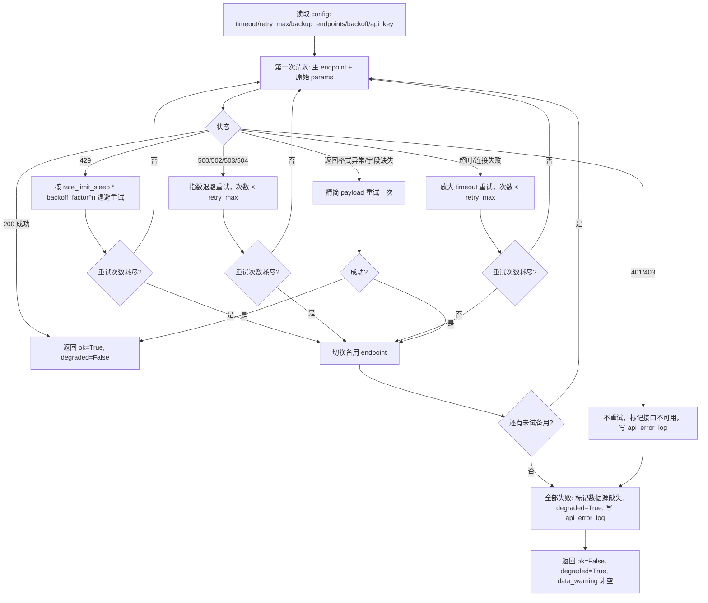

# 04. `api_adapter` 容错设计

对应 draft 中 `skill/api_adapter`，落位为 `src/fund/adapter.py`。所有外部数据请求（基金信息、财报、宏观、新闻）必须经过它，`agents/` 和 `sources/` 不允许直接发 HTTP 请求。

## 对外接口

```python
class AdapterResult(BaseModel):
    ok: bool
    data: dict | None
    degraded: bool            # True 表示降级（备用/精简后成功，或彻底失败）
    data_warning: str         # 非空表示有数据缺失/降级，供上层写入 data_warning 字段

def call_with_adapter(
    source: str,                       # 配置中 api.<source> 的 key，如 "fund_data"
    params: dict,
    request_fn: Callable[[str, dict, dict], httpx.Response],  # (endpoint, params, headers) -> Response，可注入 mock
    config: AppConfig,
) -> AdapterResult: ...
```

`request_fn` 作为参数注入是关键设计：生产代码传真实的 `httpx.get` 封装，单元测试传 fake 函数模拟任意状态码/异常，**不需要真实网络即可覆盖所有分支**。

## 状态机（严格按顺序执行，对应 draft 容错执行顺序）



## 分支与配置参数的对应关系

| 分支                 | 使用的 config 字段                                                                               |
| -------------------- | ------------------------------------------------------------------------------------------------ |
| 退避等待秒数         | `api_adapter.rate_limit_sleep * api_adapter.backoff_factor ** attempt`                           |
| 最大重试次数         | `api.<source>.retry_max`                                                                         |
| 单次超时             | `api.<source>.timeout`（超时重试时放大为 `timeout * backoff_factor`）                            |
| 备用地址列表         | `api.<source>.backup_endpoints`，按顺序逐个尝试，`api_adapter.enable_switch_backup=false` 时跳过 |
| 是否允许精简 payload | `api_adapter.auto_reduce_payload`                                                                |

`401/403` 永不重试、永不切换备用（鉴权问题换地址也没用），直接进入失败分支。

## 精简 payload 的具体策略

`request_fn` 返回"格式异常/字段缺失"时，`adapter` 对 `params` 做一次性简化（由调用方通过可选的 `reduce_fn: Callable[[dict], dict]` 参数提供，默认策略：若 `params` 里有 `codes: list`，截断为前 1 个；去掉非必需的 `extra_fields` 键）。只精简一次，精简后仍失败则进入切换备用 / 失败分支，不无限循环。

## 日志写入

每一次状态转移（首次请求、每次重试、每次切换备用、精简 payload、最终放弃）都调用 `storage.append_api_error_log(entry)` 写入一条 `ApiErrorLogEntry`（见 [03_data_model.md](03_data_model.md)）。成功请求不写日志，避免日志量膨胀。

## 可测试性设计要点（呼应 [08_testing_strategy.md](08_testing_strategy.md)）

- 不在 `adapter.py` 内部 `import time; time.sleep(...)` 直接调用，而是通过注入的 `sleep_fn: Callable[[float], None]`（默认 `time.sleep`，测试传 `lambda s: None`），保证单测秒级跑完，不真的等待。
- 所有分支都是纯状态转移 + 调用注入函数，不依赖真实网络，可以 100% mock 覆盖。
