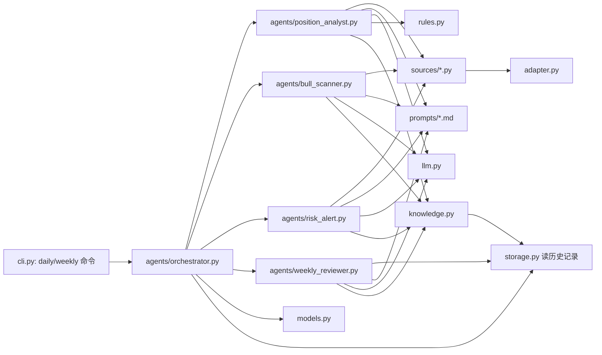

# 05. Agents / Prompts / 数据源 规范

## 分层关系



## `sources/*.py`：数据源 client

每个文件只做一件事：组装请求参数 → 调用 `adapter.call_with_adapter(...)` → 把返回的 `dict` 转成业务需要的轻量结构。**不含分析逻辑，不含 prompt**。

```python
# sources/fund_info.py
def fetch_fund_info(config: AppConfig, fund_codes: list[str]) -> AdapterResult:
    return call_with_adapter(
        source="fund_data",
        params={"codes": fund_codes},
        request_fn=http_get,
        config=config,
    )
```

四个数据源：`fund_info.py`（持仓/净值）、`stock_financial.py`（重仓个股财报）、`macro_data.py`（宏观/利率/汇率）、`industry_news.py`（行业/政策新闻）。新增数据源照此模式加文件即可。

## `rules.py`：纯函数规则引擎（Target1/2/3 的硬约束）

不依赖网络、不依赖 LLM，输入输出都是基本类型/pydantic 模型，最容易做到 100% 单测覆盖：

```python
def check_base_profit(current_yield: float, hold_days: int, fee_covered_by_gain: bool, cfg: StrategyConfig) -> tuple[Literal["持有","卖出"], str]: ...

def classify_bull_alert(expected_gain: float, confidence: int, cfg: StrategyConfig) -> Literal["buy_recommend", "watch_only"]: ...

def crash_priority_over_profit() -> bool:  # 恒定返回 True，显式建模"风险优先级 > 止盈规则"这条规则，而不是散落在调用方判断里
    return True
```

LLM 产出的 `bull_alert.confidence` 等数值，最终是否"推荐买入"由 `rules.py` 这类纯函数二次裁决，不单纯信任 LLM 输出，保证阈值（`confidence_threshold` 等）始终来自 `config.yaml` 而不是 prompt 文本。

## `knowledge.py`：知识检索与沉淀（建立在 `storage.py` 之上的业务层）

```python
def get_knowledge_context(config: AppConfig, fund_code: str, as_of: date) -> dict:
    """检索 fund_profile + 命中的 lessons_learned + 命中的 market_patterns，组装成 prompt 变量"""

def upsert_fund_profile(fund_code: str, observation: ProfileObservation) -> None: ...
def append_lesson_from_review(review: WeeklyReview) -> list[LessonLearned]: ...
def query_lessons(tags: list[str] | None = None, scope: dict | None = None) -> list[LessonLearned]: ...
def match_market_patterns(as_of: date, macro_context: dict | None = None) -> list[MarketPatternEntry]: ...
```

- `position_analyst.py` / `bull_scanner.py` / `risk_alert.py` 在组装 prompt 前，都先调用 `get_knowledge_context(...)` 拿到结构化知识，作为新增 prompt 变量 `knowledge_context` 注入（见下文 `prompts/*.md` 规范）。
- `position_analyst.py` 分析完成后调用 `upsert_fund_profile(...)` 追加今日观察。
- `weekly_reviewer.py` 复盘产出 `new_analysis_factors` 后，**必须**调用 `append_lesson_from_review(...)` 转成结构化 `LessonLearned` 写入，不允许只停留在 `weekly_review_log` 的自然语言里。
- `market_patterns` 检索采用简单规则匹配（按 `applicable_condition` 对照当前月份/宏观状态），不引入向量检索，详见 [10_knowledge_base.md](10_knowledge_base.md)。

## `prompts/*.md`：模板规范

- 纯 Markdown，用 `{{variable}}` 作占位符（避免跟 Markdown 本身的 `{}`/代码块冲突，选用双大括号）。
- 每个模板文件顶部用 HTML 注释写明所需变量清单，便于实现时核对：

```markdown
<!-- required_vars: fund_list, position_detail, financial_summary, macro_summary, news_summary, base_rule_text, knowledge_context -->

# 角色：每日持仓短线研判总分析师

...
```

- 模板必须显式要求：引用了 `knowledge_context` 里的某条 `lesson_id` / `pattern_id` / `fund_profile` 观察时，必须在 `analysis_argument` 对应字段里注明来源 id（如"参考 L-2026W43-01"），保证分析结论可溯源、真正用上了积累的经验。

- `agents/*.py` 用统一的 `load_prompt(name: str, **vars) -> str`（放在 `llm.py` 或新增 `prompt_loader.py`，视实现时体量决定）加载并填充模板，模板文件内容本身来自 draft 文档第五章，做少量变量化改造（如从调用方传入 `base_rule_text` 而不是整段写死在模板里，方便 weekly 复盘后更新规则文案时只改一个来源）。

## `agents/*.py`：职责边界

| 文件                  | 输入                               | 输出                                                | 说明                              |
| --------------------- | ---------------------------------- | --------------------------------------------------- | --------------------------------- |
| `position_analyst.py` | 持仓明细 + 各数据源结果            | 单只基金的 `AnalysisRecord`（除 bull/crash 子字段） | 对应 Target1 + Target4            |
| `bull_scanner.py`     | 持仓 + 备选池 + 数据源结果         | `BullAlert`                                         | 对应 Target2                      |
| `risk_alert.py`       | 历史判断 + 最新数据                | `CrashRisk`                                         | 对应 Target3                      |
| `weekly_reviewer.py`  | 本周全部 `analysis_log` + 真实净值 | `WeeklyReview`                                      | 对应 weekly 复盘闭环              |
| `orchestrator.py`     | 无（命令行触发）                   | 调用上面几个 agent，合并落盘                        | 对应 Daily/Weekly Button 调度逻辑 |

每个 agent 函数签名统一形如 `def run(config: AppConfig, ...) -> SomeModel`，**内部允许调用 LLM，也允许在 LLM 不可用/未配置时走纯规则兜底路径**（例如第一阶段实现时 `llm.py` 可以先提供一个"假 provider"返回占位结构，保证整条链路可测、可跑，真实 LLM 接入是后续独立 feature 点）。

## `llm.py`：LLM 调用薄封装

```python
def call_llm(config: AppConfig, prompt: str) -> str: ...
```

内部按 `config.llm.provider` 分发（如 `"openai"`、`"fake"`）。`"fake"` provider 用于离线单测：返回固定/可配置的 JSON 字符串，不发真实请求。真实 provider 接入放在 feature checklist 的靠后阶段，不阻塞前面模块的开发和测试。
