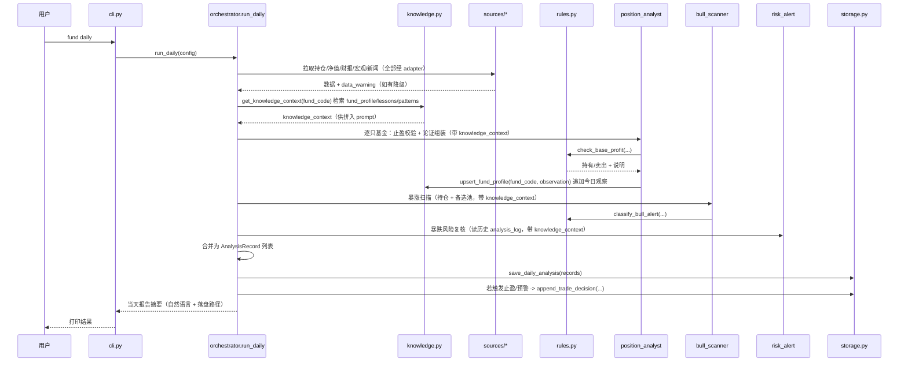
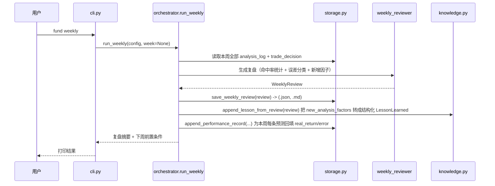

# 06. Daily / Weekly 主流程

## Daily（对应【Daily Button】）

关键约束：

- 任一数据源降级（`adapter` 返回 `degraded=True`），对应 `AnalysisRecord.data_warning` 必须非空，且该基金当天结论不得输出"置信度 100% 的强推荐"（由 `rules.py` 统一兜底：`data_warning` 非空时，`bull_alert.confidence` 上限封顶，具体数值作为 feature 点实现时定，默认不超过 `confidence_threshold - 1`，即自动降为"观察"）。
- `risk_alert` 优先级高于止盈规则：`orchestrator` 合并结论时，若 `crash_risk.is_crash=True`，`final_decision` 固定取"减仓/清仓"分支，不被 `base_profit_signal="持有"` 覆盖。

## Weekly（对应【Weekly Button】）

复盘产出的 `prompt_optimize_content` / `next_week_context` 作为**纯文本**存入 `WeeklyReview`，下次 `run_daily` 执行时由 `orchestrator` 读取最近一次 `weekly_review_log` 并拼入 `daily_analysis` 的 prompt 变量（如 `base_rule_text` 追加段落），形成闭环。**不自动改 `rules.py` 代码**——代码阈值调整仍需人工看复盘报告后手动改 `config.yaml`，避免 AI 自动改规则导致不可控。

`week` 参数说明：`week=None` 时 `orchestrator.run_weekly` 内部调用 `compute_default_week(date.today())` 取"当前自然周的上一周"（`YYYY-Www` 格式）；`cli.py` 的 `--week` 与 Web UI 的 `POST /api/weekly` 共用这同一个默认值计算函数，不各写一套。详细设计见 [11_web_ui.md](11_web_ui.md) 第 5 节。
