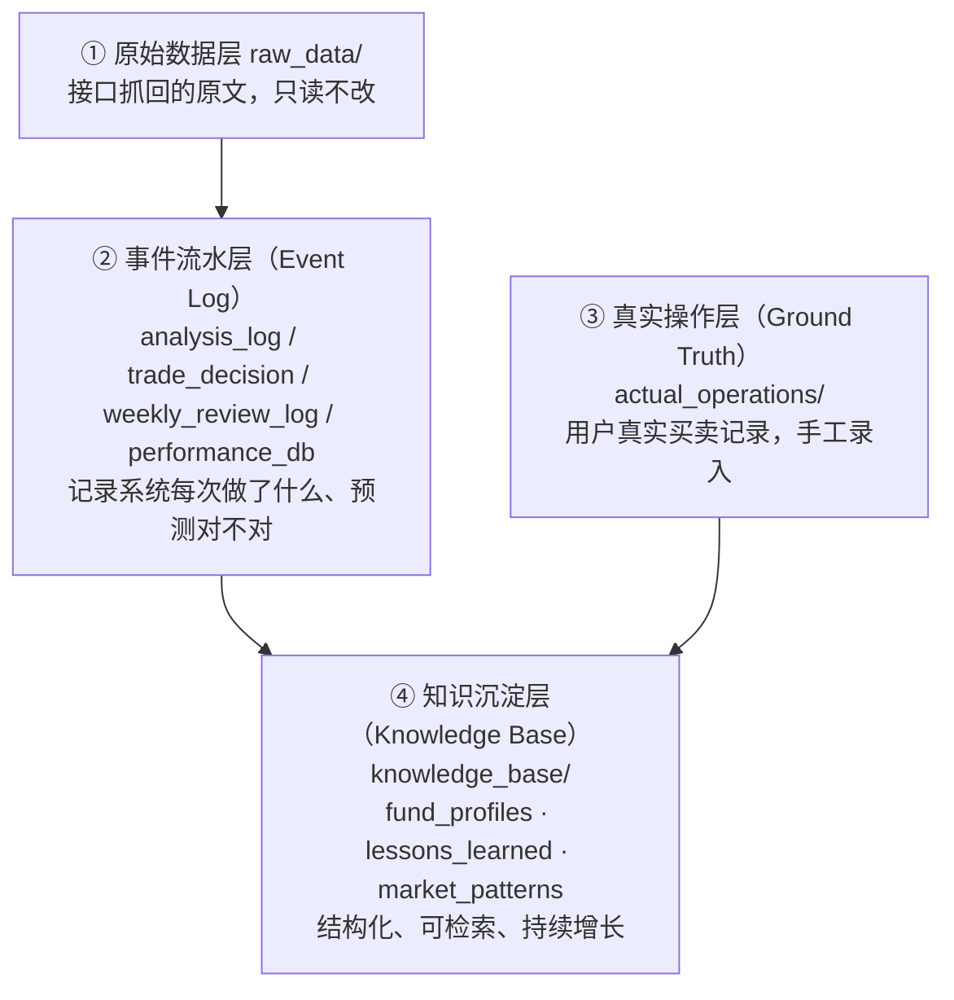
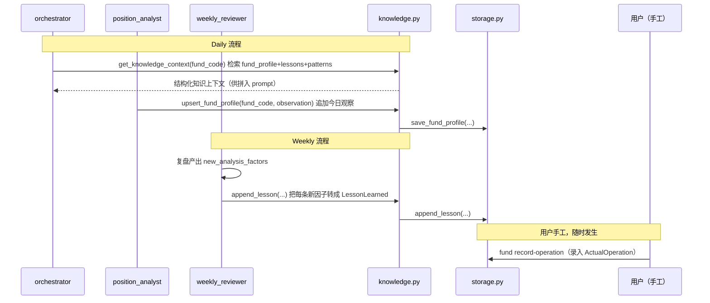

# 10. 数据积累与知识库设计（系统的核心资产层）

> 这是整个项目**价值密度最高**的一块：单次分析准不准是运气，长期能不能越跑越准，取决于"历史操作、经验教训、长期市场规律"能不能被结构化沉淀、被检索、被复用。本篇是对 [03_data_model.md](03_data_model.md) 的专题补充，重点讲**为什么这样设计、谁在什么时候写入、agent 怎么用**。

## 1. 数据分层模型（四层，层层递进）

- 第①②层是已有设计（见 03_data_model.md 1~5 节），解决"发生了什么、预测准不准"。
- 第③层是**新增**：区分"AI 给的建议"（`TradeDecision`）和"用户真的做了什么"（`ActualOperation`）。没有这一层，系统永远不知道自己的建议有没有被采纳、采纳后效果如何——这是闭环里最容易被忽略但最关键的一环。
- 第④层是**新增**：把②③层里反复出现的规律提炼成可检索的结构化知识，而不是让分析每次都从 LLM 的"当场发挥"重新开始。这一层让系统"基本所有都数据驱动"。

## 2. 知识沉淀层细分（三类，详细字段见 [03_data_model.md](03_data_model.md) 第 6 节）

| 类型               | 目录            | 回答的问题                                                                                              | 更新主体                                              | 更新频率     |
| ------------------ | --------------- | ------------------------------------------------------------------------------------------------------- | ----------------------------------------------------- | ------------ |
| `fund_profiles/`   | 每基金一个 JSON | "这只基金历史上在类似环境下表现如何、经理风格是什么"                                                    | 系统自动（daily 后追加观察）                          | 每天增量     |
| `lessons_learned/` | 单一 JSONL      | "我们曾经因为什么判断失误 / 做对了什么，可复用的经验是什么"                                             | 系统自动（weekly 复盘后转换写入）                     | 每周增量     |
| `market_patterns/` | 单一 JSON       | "近几十年市场在什么条件下反复出现什么规律"（美林时钟、利率周期、季节性如春季躁动/红包行情、政策周期等） | **人工为主**（AI 可协助整理草稿，入库前必须人工审阅） | 偶发，不定期 |

**为什么 `market_patterns` 不让系统自动写**：这是跨越几十年的慢变量参考知识，一旦被某次 LLM 幻觉污染，会长期误导后续所有分析且难以察觉。其余两类数据体量小、来源可追溯（直接来自本系统的历史记录），自动写入风险可控，因此允许自动化。

## 3. 真实操作层：为什么要单独建 `actual_operations/`

- `TradeDecision`（已有）= AI 给出的信号/建议，发生在"系统输出层"。
- `ActualOperation`（新增）= 用户真实执行了什么，发生在"现实世界"。
- 两者通过 `ActualOperation.related_signal_id` 关联，但**允许不关联**（用户可能没按建议操作，也可能操作了但系统没给过信号）。
- 有了这一层，才能回答这些数据驱动的核心问题：
  - 系统的止盈/暴涨/暴跌信号，用户实际采纳率是多少？
  - 采纳了的信号，真实收益和预测收益差多少？（这是 `PerformanceRecord.error` 的更真实版本——`PerformanceRecord` 比较的是"预测 vs 市场实际走势"，`ActualOperation` 比较的是"预测 vs 用户实际决策结果"，两者互补）
- 录入方式：CLI 新增 `fund record-operation` 命令（见 [07_cli_and_ui.md](07_cli_and_ui.md)），**完全手工录入，系统不猜测、不编造用户的真实操作**。

## 4. 检索策略：保持简单，不引入向量数据库

当前规模（个人单用户、持仓基金数量有限）不需要 Qdrant / embedding，按字段过滤即可满足"数据驱动"的检索需求：

| 知识类型          | 检索方式                                                                                                                                       |
| ----------------- | ---------------------------------------------------------------------------------------------------------------------------------------------- |
| `fund_profiles`   | 按 `fund_code` 精确查（一基金一文件，直接读）                                                                                                  |
| `lessons_learned` | 按 `tags` 交集 + `applicable_scope`（`fund_code` / `sector` / `market_wide`）过滤，`status="active"` 的才参与                                  |
| `market_patterns` | 按 `pattern_type` + `applicable_condition` 做简单规则匹配（如当前月份落在"每年 1-2 月" → 命中"春季躁动"条目），纯字符串/日期规则，不做语义检索 |

若未来数据量或检索复杂度显著增长（如需要语义相似度匹配长文本教训），再评估引入轻量向量检索——**这是 Optional，明确放在 Feature checklist Phase 7 之后，不在当前范围内**，避免为"看起来更智能"而提前引入基础设施。

## 5. 写入时机（谁在什么时候写）

- **daily**：`orchestrator.run_daily` 在调用各 agent 前，先用 `knowledge.get_knowledge_context(fund_code, as_of=today)` 取回相关 `fund_profile` + 命中的 `lessons_learned` + 命中的 `market_patterns`，作为新增 prompt 变量 `knowledge_context` 注入（见 [05_agents_skills_prompts.md](05_agents_skills_prompts.md)）；分析完成后，`position_analyst` 追加一条 `ProfileObservation` 到该基金的 `FundProfile`。
- **weekly**：`weekly_reviewer` 产出的 `new_analysis_factors` **必须**同时调用 `knowledge.append_lesson(...)` 落成结构化 `LessonLearned`，不能只停留在 `weekly_review_log` 的自然语言里——这是把"写复盘报告"升级为"真正积累经验"的关键一步，否则教训下次不会被自动检索到。
- **market_patterns**：不在上述自动流程中写入，走单独的人工维护流程（见下）。
- **actual_operations**：完全手工，CLI 命令录入。

## 6. `market_patterns` 的初始化与维护流程（人工主导）

1. **初始建库（一次性）**：由用户提供素材或请 AI 协助检索整理"近几十年 A 股/基金市场运行规律"（如美林时钟与大类资产轮动、历次降息周期后权益类基金的平均表现、季节性效应如春季躁动/红包行情、换届/政策周期规律等），AI 整理成 `MarketPatternEntry` 草稿列表。
2. **人工审阅**：用户逐条确认 `description`、`historical_evidence`、`source` 是否属实可信，删改后才落盘到 `data/knowledge_base/market_patterns/patterns.json`。
3. **后续增补**：每次复盘或日常阅读研报，发现新的长期规律，手工（或由 AI 起草、人工确认）追加条目，不要求频繁更新。
4. 落地为 Feature checklist 中的一个独立功能点（初始建库 ≥ 5~10 条有效规律即可开始使用，不要求一次做全）。

## 7. 对 Agent 层的要求：分析结论必须"可溯源"

`daily_analysis` prompt 新增约束（落位 [05_agents_skills_prompts.md](05_agents_skills_prompts.md) 的模板规范）：当分析引用了 `knowledge_context` 里的某条 `lesson_id` / `pattern_id` / `fund_profile` 观察时，必须在 `analysis_argument` 对应字段中注明来源 id（如"参考 L-2026W43-01：..."）。这样可以客观检查"这次分析是不是真的用上了积累的经验"，而不是 LLM 泛泛而谈。

## 8. 小结：这一篇解决的三件事

1. 新增「真实操作」数据（`actual_operations/`），让系统能对照"建议 vs 用户真实决策"算账。
2. 新增「经验教训」沉淀（`lessons_learned/`），把每周复盘从"写报告"升级为"真正积累可检索经验"。
3. 新增「长期市场规律」参考库（`market_patterns/`），把"近几十年的运行规律综合总结"固化为人工审阅过的结构化知识，供每次分析引用，而不是依赖 LLM 当场的模糊记忆。

对应的模型定义见 [03_data_model.md](03_data_model.md) 第 6 节；对应的 Feature checklist 见 [09_feature_checklist.md](09_feature_checklist.md) Phase 2.5。
