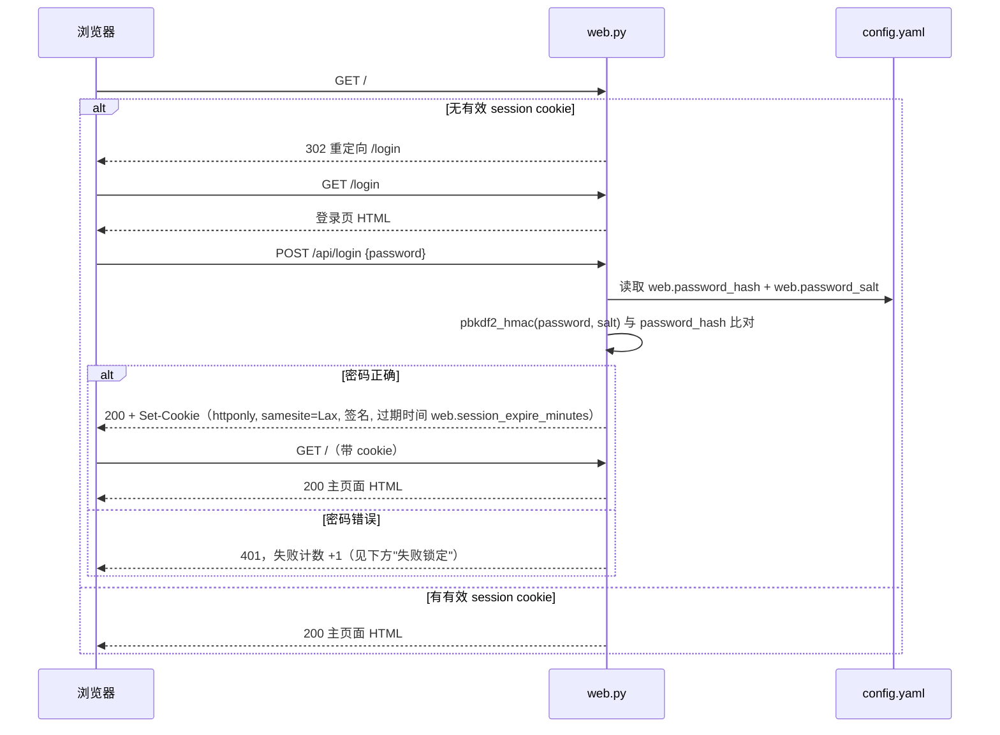

# 11. Web UI 详细设计（登录 + 主页面 + TODO 小窗口）

> 对应 [09_feature_checklist.md](09_feature_checklist.md) 的 **Phase 7 · F7.3（Optional）**。沿用 [00_overview.md](00_overview.md) 设计原则 5"先 CLI 后 UI"：本设计不改变 CLI 是第一实现路径这件事，只是把 Optional 的 Web UI 这一项的细节一次性设计到位，真正实现时仍按 Phase 顺序推进（Phase 0~6 全部完成后才轮到这里，除非用户明确要求提前）。

## 0. 范围与前提

- 单用户本地工具，**不做多用户 / 注册 / 权限分级**，只有"一个密码，登录后看到全部功能"这一种角色（与 [00_overview.md](00_overview.md) 非目标"不做分布式/多用户系统"一致）。
- 默认只绑定 `127.0.0.1`，不对局域网/公网暴露；如需局域网访问，需要用户显式修改 `config.yaml` 的 `web.host`，并在文档里提示风险（见第 8 节）。
- 新增依赖：`flask`（轻量、无需额外构建工具链，纯 Python）。前端不引入 npm/构建步骤，页面是服务端渲染的纯 HTML + 原生 JS（`fetch` 调 API），保持"保持简单"的仓库总原则。
- 新增代码文件（都遵循"新增能力=新增文件"原则，不改动已有的 `cli.py`/`orchestrator.py` 内部结构，只新增函数）：
  - `src/fund/web.py` — Flask app 工厂 + 路由 + 登录校验中间件
  - `src/fund/web_static/login.html`、`index.html`、`app.js`、`style.css` — 纯静态页面资源
  - `agents/orchestrator.py` 新增两个纯函数：`compute_default_week(as_of: date) -> str`（计算"上一自然周"）、`list_missing_weekly_reviews(config, as_of: date, lookback_weeks: int) -> list[str]`（TODO 小窗口数据源）

## 1. 页面与路由总览

| 路径          | 方法 | 需要登录 | 作用                                                                   |
| ------------- | ---- | -------- | ---------------------------------------------------------------------- |
| `/login`      | GET  | 否       | 登录页（纯静态 HTML，内嵌一个密码输入框 + 提交按钮）                   |
| `/api/login`  | POST | 否       | 校验密码，成功则签发 session cookie                                    |
| `/api/logout` | POST | 是       | 清除 session cookie                                                    |
| `/`           | GET  | **是**   | 主页面（未登录一律 302 重定向到 `/login`）                             |
| `/api/todo`   | GET  | 是       | 返回缺失复盘周列表，供 TODO 小窗口渲染                                 |
| `/api/daily`  | POST | 是       | 触发一次 Daily（可选 body: `{"fund_code": "000001"}`）                 |
| `/api/weekly` | POST | 是       | 触发一次 Weekly（可选 body: `{"week": "2026-W43"}`，不传默认"上一周"） |

## 2. 登录流程设计



### 安全要点（对照 OWASP，必须全部落实）

1. **密码不落明文**：`config.yaml` 只存 `web.password_salt`（随机生成）+ `web.password_hash`（`hashlib.pbkdf2_hmac("sha256", password, salt, 200_000)` 的结果），`config.example.yaml` 留空占位符，不出现真实密码或 hash。
2. **会话签名**：用 `web.secret_key`（随机字符串，本地生成，写入 `config.yaml`，不提交）对 session cookie 签名（Flask 自带的 `itsdangerous` 签名 session 即可），防止客户端篡改。
3. **Cookie 安全属性**：`HttpOnly`（防 XSS 读取）、`SameSite=Lax`（防基础 CSRF）、本地无 HTTPS 时 `Secure` 可关闭，但要在文档中注明"仅限 `127.0.0.1` 本机场景，若改绑其他网卡必须配 HTTPS 并打开 `Secure`"。
4. **失败锁定**：进程内维护一个"最近失败次数"计数器（内存即可，无需落盘），连续失败 ≥ 5 次后锁定该来源 IP 5 分钟，防暴力破解；不做分布式限流（单实例单用户场景不需要）。
5. **默认绑定 `127.0.0.1`**：`web.host` 默认值固定为 `127.0.0.1`，改成 `0.0.0.0` 需要用户在 `config.yaml` 手动修改，`AGENTS.md` 硬约束自查清单后续补充一条"不擅自把 `web.host` 改成 `0.0.0.0`"。
6. 所有 `/api/*`（除 `/api/login`）统一经过一个 `require_login` 装饰器校验 session，校验失败一律 401，不做"部分放行"。

## 3. 主页面布局（登录后的 `/`）

```text
┌──────────────────────────────────────────────────────────┐
│  短线基金 AI 分析平台                         [退出登录]  │  <- 顶部 header
├──────────────────────────────────────────────────────────┤
│  【Daily】                                                │
│  基金代码（可选）: [________]   [ 生成今日分析 ]           │
│  上次运行：2026-11-06 18:02（无数据降级）                  │
├──────────────────────────────────────────────────────────┤
│  【Weekly】                                                │
│  指定周（可选，默认上一周）: [2026-W45 ▾]  [ 生成复盘 ]    │
│  上次运行：2026-W44（已生成）                               │
└──────────────────────────────────────────────────────────┘
                                                 ┌───────────┐
                                                 │ TODO (3) ▾│  <- 右下角悬浮小窗口
                                                 ├───────────┤
                                                 │2026-W43   │
                                                 │  没有生成  │
                                                 │  复盘数据  │
                                                 │  [去生成] │
                                                 │2026-W44   │
                                                 │  ...      │
                                                 └───────────┘
```

- 顶部 header 右侧"退出登录"调用 `POST /api/logout` 后跳转 `/login`。
- Daily / Weekly 两块都是对现有 CLI 功能的网页等价物，点击按钮即 `fetch(POST /api/daily|weekly)`，返回摘要后原地刷新"上次运行"文案（不整页刷新）。
- Weekly 的"指定周"下拉框：选项来自 `GET /api/todo` 返回的缺失周列表 + 手动输入兜底（允许用户输入任意 `YYYY-Www` 格式补跑更早的周）；留空提交即不传 `week` 字段，后端按"默认上一周"处理。

## 4. TODO 小窗口设计

- **位置与交互**：固定在页面右下角，默认展开；标题栏 `TODO (N)` 右侧一个 `▾/▸` 图标点击收起/展开；收起状态只保留标题栏这一行。展开/收起状态用 `localStorage` 记一个布尔值即可（纯前端偏好，不需要后端存储，也不需要新数据模型）。
- **数据来源**：`GET /api/todo` 调用 `orchestrator.list_missing_weekly_reviews(config, as_of=今天, lookback_weeks=config.web.todo_lookback_weeks)`：
  - 从"项目启动周"（取 `data/analysis_log/` 中最早一条记录所在的自然周；若 `analysis_log` 为空则取今天所在周）开始，逐周检查 `data/weekly_review_log/` 下是否存在对应的 `YYYY-Www-review.json`。
  - 跳过"当前自然周"（当前周尚未结束，不算缺失）与"今天所在周之后"的周。
  - 最多只回看 `lookback_weeks` 周（`config.yaml` 可配，默认 `8`），避免项目跑久了列表越滚越长。
  - 返回示例：`{"missing_weeks": ["2026-W43", "2026-W44"]}`（按时间正序）。
- **展示文案**：每一项固定模板"`{week} 周没有生成复盘数据，请生成`"，附一个"去生成"按钮；点击直接 `fetch(POST /api/weekly, {week})`，成功后前端把该项从列表移除（不用整页刷新，也不用重新 GET 一次 `/api/todo`，减少一次请求；下次打开页面会重新拉取真实状态做兜底校正）。
- **不做的事**：不持久化"用户已忽略某一周"这种状态（如果需要"忽略"语义，属于后续再评估的功能，当前不设计、不实现，避免过度设计）。

## 5. Weekly "指定某一周"参数设计

- `cli.py` 已有 `--week` 可选参数（见 [07_cli_and_ui.md](07_cli_and_ui.md)），Web API `POST /api/weekly` 的 `week` 字段与之语义完全一致，两者共用同一个默认值计算函数，不各写一套逻辑。
- 新增纯函数 `orchestrator.compute_default_week(as_of: date) -> str`：
  - 定义：`as_of` 所在 ISO 自然周的**上一周**，格式化为 `YYYY-Www`（如 `2026-W44`）。
  - `cli.py` 的 `fund weekly` 不传 `--week` 时调用它；Web 端 `POST /api/weekly` 不传 `week` 字段时同样调用它——**只有这一处实现，两个入口复用**。
- `orchestrator.run_weekly(config, week: str | None = None)`：`week=None` 时内部调用 `compute_default_week(date.today())`；`week` 给定时做格式校验（必须匹配 `YYYY-Www` 且不晚于当前自然周的上一周，晚于则报参数错误，不允许"预测未来周"）。
- 同步更新 [06_daily_weekly_flow.md](06_daily_weekly_flow.md) 的 Weekly 时序图，把 `CLI->>ORCH: run_weekly(config)` 改为 `run_weekly(config, week=None)` 并补充这条默认值说明（见该文档改动）。

## 6. API 契约表

| 接口               | 请求体                                              | 成功响应                                                                    | 失败响应                                                                                    |
| ------------------ | --------------------------------------------------- | --------------------------------------------------------------------------- | ------------------------------------------------------------------------------------------- |
| `POST /api/login`  | `{"password": "..."}`                               | `200 {"ok": true}` + Set-Cookie                                             | `401 {"ok": false, "error": "密码错误"}` / `429 {"error": "失败次数过多，请 5 分钟后再试"}` |
| `POST /api/logout` | 无                                                  | `200 {"ok": true}`                                                          | —                                                                                           |
| `GET /api/todo`    | —                                                   | `200 {"missing_weeks": ["2026-W43", ...]}`                                  | `401` 未登录                                                                                |
| `POST /api/daily`  | `{"fund_code": "000001"}`（可选，省略则跑全部持仓） | `200 {"data_warning_funds": [...], "report_path": "...", "summary": {...}}` | `401` 未登录；`500` 内部异常（附简要 message，不泄露堆栈）                                  |
| `POST /api/weekly` | `{"week": "2026-W43"}`（可选，省略则取上一周）      | `200 {"week": "2026-W43", "report_path": "...", "summary": {...}}`          | `401` 未登录；`400` week 格式非法/晚于允许范围                                              |

## 7. 安全检查清单（实现 F7.3 时逐条自查，补充进 [AGENTS.md](../AGENTS.md) 第 4 节硬约束）

- [ ] 密码只以 `pbkdf2_hmac` 加盐哈希形式存在 `config.yaml`，没有任何明文密码出现在代码/日志/提交记录里。
- [ ] `web.secret_key` / `web.password_salt` / `web.password_hash` 三个字段都走 `${ENV}` 或本地 `config.yaml`，`config.example.yaml` 留空占位符。
- [ ] `web.host` 默认 `127.0.0.1`，没有被硬编码成 `0.0.0.0`。
- [ ] 所有 `/api/*`（除 `/api/login`）都经过 `require_login` 校验，没有遗漏的接口。
- [ ] 登录失败有计数锁定，没有允许无限次暴力尝试。
- [ ] `POST /api/weekly` 的 `week` 参数做了格式校验和"不晚于上一周"的范围校验，不会被用来触发对未来周的分析。
- [ ] 前端没有引入任何第三方 CDN 脚本（避免供应链风险），`app.js`/`style.css` 都是本地文件。

## 8. 与 Feature Checklist 的对应

详见 [09_feature_checklist.md](09_feature_checklist.md) Phase 7 的 F7.3.1 ~ F7.3.4 子项（登录与会话、TODO 接口、Weekly 周参数联动、静态页面与样式）。本文档是这些子项的唯一设计依据，实现时不再另外临场设计。
