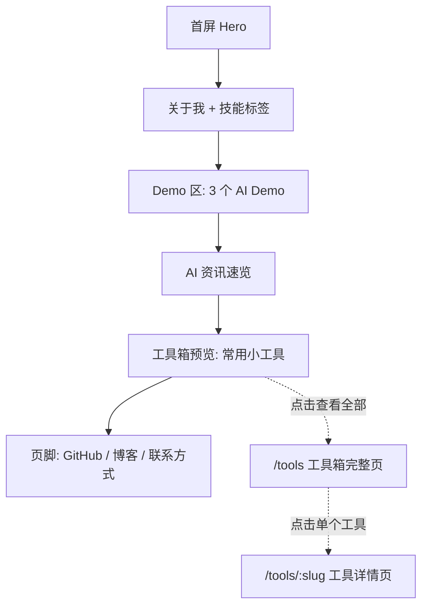

# 00 — 项目总览

## 1. 项目定位

一个**单页个人主页**，核心目的是让访客（面试官/HR/合作方）在 30 秒内：

1. 知道你是谁、做什么方向
2. 看到 3 个「活的」AI Demo，直观感受你的 AI 工程能力
3. 浏览每日自动更新的 AI 资讯，感受你的自动化工作流能力
4. 顺手用几个免费小工具，留下更长的停留时间
5. 能找到你的 GitHub、博客、联系方式

**不是**：博客、作品集、SaaS 产品、DA-01。

### 内容三大支柱（持续迭代）

本站内容分三类，长期演进方式不同：

| 支柱            | 当前状态              | 迭代方式                                          |
| --------------- | --------------------- | ------------------------------------------------- |
| **AI 能力演示** | 3 个 Demo 已设计      | 数量基本固定，迭代重在优化体验                    |
| **AI 资讯速览** | 对接 `project/aiNews` | 每日自动追加，内容自己会长                        |
| **常用小工具**  | 规划中，持续新增      | 走「注册表 + 独立组件」模式，随时加新工具不改架构 |

## 2. 信息架构

首页（`/`）单页滚动，5 个大区块。工具箱会持续新增，首页只做「精选预览 + 查看全部」入口，完整工具列表和工具详情拆到独立路由（`/tools`、`/tools/:slug`），避免首页随工具增多无限变长。

## 3. 页面结构

### 3.1 Hero 区（首屏）

- 姓名 / 花名
- 一句话定位：「全栈工程师 · AI 应用方向」
- 3 个 CTA 按钮：GitHub / 博客 / 联系我
- 背景：极简渐变或粒子动画（轻量）

### 3.2 关于我

- 2–3 句话自我介绍
- 技能标签云（React / TypeScript / Python / LLM / RAG / Agent / ...）
- 不列工作经历（那是简历的事），只给技术方向感

### 3.3 Demo 区（核心）

3 个可交互的 AI Demo 卡片，每个卡片包含：

- 标题 + 一句话说明
- 输入区（文本框/代码框/文件上传区）
- 输出区（AI 返回结果，带 loading 动画）
- 「技术点」标签（如 RAG / Tool Calling / Streaming）

### 3.4 AI 资讯速览（NewsFeed）

**定位**：展示 `project/aiNews` 每日自动收集的 AI 技术资讯，证明「AI 自动化工作流」能力。

**数据来源**：

- 静态 JSON 文件，由 aiNews 收集流程自动生成，存放在 `public/data/` 下
- 每次 aiNews 跑完后，自动/手动更新 JSON → 主页自动刷新内容
- 不依赖后端、不实时抓取，纯静态

**展示内容**：

- 最近 7 天的资讯摘要列表（日期 + 一句话概括）
- 每条可点击展开看 Top 3 详情（标题 + 来源 + 链接）
- 顶部显示「最近更新：YYYY-MM-DD」
- 底部链接：「查看更多 AI 资讯 →」指向 aiNews 产出目录或 GitHub

**技术点展示**：

- 自动化数据管道（aiNews 收集 → JSON → 静态站点）
- 前端数据加载与渲染
- 增量静态内容更新

### 3.5 工具箱（Toolbox，持续新增）

**定位**：一组免费、即开即用的小工具，留住访客、提升实用性，同时证明「随手把需求做成产品」的工程习惯。详细设计见 [05_tools.md](05_tools.md)。

**首页展示**：

- 精选 4–6 个工具卡片（图标 + 名称 + 一句话说明）
- 每张卡片点击直接跳转到 `/tools/:slug` 独立页面使用
- 底部「查看全部工具 →」链接到 `/tools` 完整列表页

**扩展方式**：

- 新增工具 = 在 `src/tools/registry.ts` 追加一条元数据 + 新建一个工具组件文件，不改动首页/路由/布局代码
- 工具分「纯前端工具」（零成本，无需 AI）和「AI 增强工具」（需复用统一的 token 限制逻辑）两类

**技术点展示**：

- 路由懒加载（`React.lazy` + `Suspense`，每个工具独立 chunk）
- 注册表驱动的可扩展架构（Registry Pattern）
- 分类/搜索的轻量前端交互

### 3.6 页脚

- GitHub 链接
- 博客链接
- 邮箱（可选）

## 4. 三个 Demo 设计

### Demo 1：智能问答（RAG 雏形）

**场景**：访客问一个关于你的技术栈的问题，AI 从预设知识库回答。

**技术点展示**：

- 前端 streaming 输出（逐字显示）
- 预设 system prompt（知识库是静态 JSON，不搭向量库）
- Token 计数 + 硬限制

**交互**：

- 输入框 + 发送按钮
- 几个预设问题快捷按钮（「你擅长什么技术？」「RAG 是什么？」）
- AI 回复区，流式输出

### Demo 2：代码解释/转换

**场景**：访客贴一段代码，AI 解释它做了什么，或转换成另一种语言。

**技术点展示**：

- Structured Output（要求 AI 返回 JSON：`{ explanation, language, converted? }`）
- 代码高亮显示（用轻量 highlight.js 或 Prism）
- 支持粘贴 + 语言选择

**交互**：

- 代码输入框（textarea，等宽字体）
- 目标语言下拉框（解释 / Python / TypeScript / Go）
- 输出区：解释文字 + 转换后代码（带语法高亮）

### Demo 3：文档摘要

**场景**：访客贴一段长文本，AI 生成 3 句话摘要 + 3 个关键词。

**技术点展示**：

- 长文本截断 + token 预算管理
- Few-shot prompt 示例
- 输出格式化（摘要 + 关键词分开渲染）

**交互**：

- 文本输入区（较大 textarea）
- 「生成摘要」按钮
- 输出区：摘要卡片 + 关键词标签

## 5. 工具箱首批候选清单

> 完整架构设计（注册表、目录约定、新增流程）见 [05_tools.md](05_tools.md)，这里只列产品侧候选清单，用于确定首批做哪几个。

| 工具                  | 类型    | 是否需要 AI | 优先级        |
| --------------------- | ------- | ----------- | ------------- |
| JSON 格式化 / 校验    | 纯前端  | 否          | P0（首批）    |
| 正则表达式测试器      | 纯前端  | 否          | P0（首批）    |
| Markdown 实时预览     | 纯前端  | 否          | P0（首批）    |
| 时间戳 ⇄ 日期转换     | 纯前端  | 否          | P1            |
| Base64 / URL 编解码   | 纯前端  | 否          | P1            |
| Commit Message 生成器 | AI 增强 | 是          | P1            |
| 自然语言转正则表达式  | AI 增强 | 是          | P2（backlog） |
| 颜色对比度检查        | 纯前端  | 否          | P2（backlog） |

**选型原则**：优先做「纯前端、零 AI 成本、通用高频」的工具打底，AI 增强工具作为锦上添花，且必须复用 Demo 区已有的 `useAiChat` + token 限制逻辑，不单独起一套 AI 调用方式。

## 6. 非功能需求

| 需求               | 标准                                             |
| ------------------ | ------------------------------------------------ |
| 首屏加载           | < 2s（Lighthouse 90+）                           |
| AI 响应            | < 5s（小模型 + streaming）                       |
| 单次 AI 调用 token | ≤ 2048（输入+输出合计）                          |
| 移动端             | 响应式，手机可正常浏览交互                       |
| 暗色模式           | 支持（默认跟随系统）                             |
| 国际化             | 中文即可，代码注释英文                           |
| 工具独立 chunk     | 每个工具页面 bundle 增量 < 50KB gzip             |
| 工具可分享         | 每个工具有独立 URL（`/tools/:slug`），可直接分享 |
