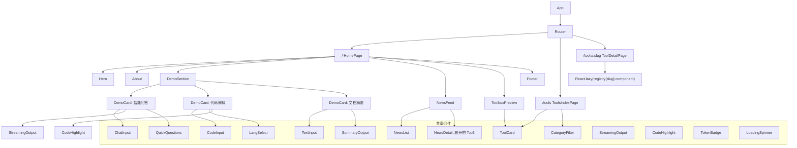
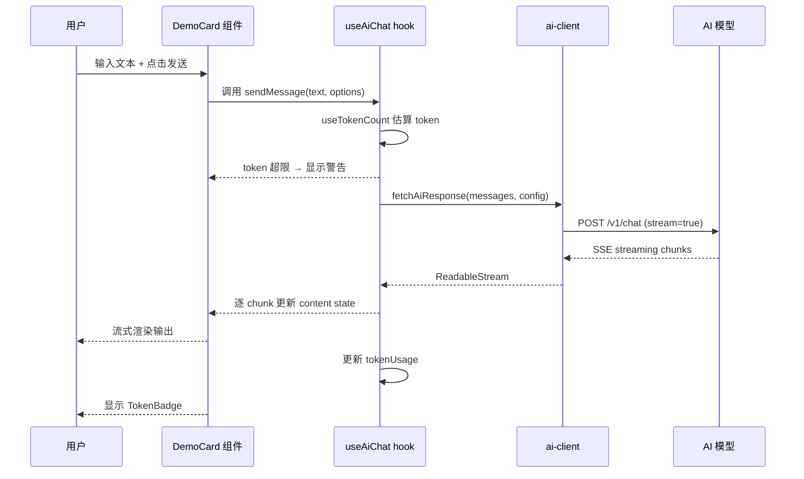
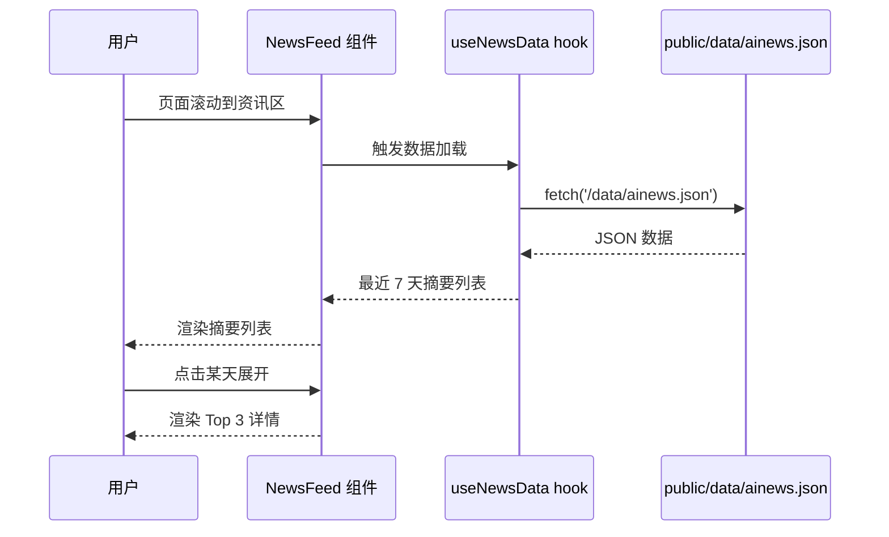
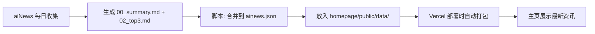
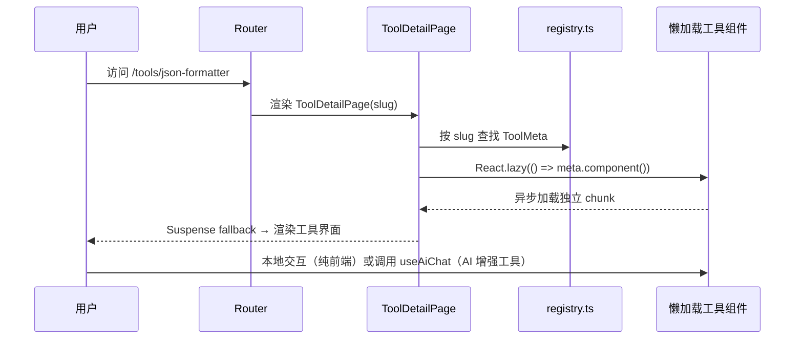

# 02 — 页面与组件树

## 1. 组件树



## 2. 组件清单

### 2.1 页面级组件

| 组件             | 文件                           | 职责                                                                        |
| ---------------- | ------------------------------ | --------------------------------------------------------------------------- |
| `App`            | `src/App.tsx`                  | 根组件，挂载 Router                                                         |
| `HomePage`       | `src/pages/HomePage.tsx`       | 首页：单页滚动容器，挂载 Hero/About/Demo/News/工具预览/Footer，暗色模式切换 |
| `ToolsIndexPage` | `src/pages/ToolsIndexPage.tsx` | `/tools`：全部工具网格 + 分类筛选                                           |
| `ToolDetailPage` | `src/pages/ToolDetailPage.tsx` | `/tools/:slug`：懒加载单个工具组件 + 返回链接                               |

### 2.2 区块组件

| 组件             | 文件                                | 职责                                              |
| ---------------- | ----------------------------------- | ------------------------------------------------- |
| `Hero`           | `src/components/Hero.tsx`           | 首屏：姓名、定位、CTA 按钮、背景动效              |
| `About`          | `src/components/About.tsx`          | 自我介绍 + 技能标签云                             |
| `DemoSection`    | `src/components/DemoSection.tsx`    | Demo 区标题 + 3 个 DemoCard 容器                  |
| `NewsFeed`       | `src/components/NewsFeed.tsx`       | AI 资讯速览区块（最近 7 天摘要列表）              |
| `ToolboxPreview` | `src/components/ToolboxPreview.tsx` | 首页工具箱预览（精选 4–6 个 ToolCard + 查看全部） |
| `Footer`         | `src/components/Footer.tsx`         | GitHub/博客/邮箱链接                              |

### 2.3 Demo 组件

| 组件          | 文件                          | 职责                                                 |
| ------------- | ----------------------------- | ---------------------------------------------------- |
| `DemoCard`    | `src/components/DemoCard.tsx` | 通用 Demo 卡片外壳（标题、描述、技术标签、内容插槽） |
| `ChatDemo`    | `src/demos/ChatDemo.tsx`      | Demo 1：智能问答                                     |
| `CodeDemo`    | `src/demos/CodeDemo.tsx`      | Demo 2：代码解释/转换                                |
| `SummaryDemo` | `src/demos/SummaryDemo.tsx`   | Demo 3：文档摘要                                     |

### 2.4 共享 UI 组件

| 组件              | 文件                                 | 职责                                                      |
| ----------------- | ------------------------------------ | --------------------------------------------------------- |
| `ChatInput`       | `src/components/ChatInput.tsx`       | 输入框 + 发送按钮（通用）                                 |
| `StreamingOutput` | `src/components/StreamingOutput.tsx` | 流式文本渲染（逐字显示动画）                              |
| `CodeInput`       | `src/components/CodeInput.tsx`       | 代码输入 textarea（等宽字体）                             |
| `CodeHighlight`   | `src/components/CodeHighlight.tsx`   | 代码语法高亮展示                                          |
| `QuickQuestions`  | `src/components/QuickQuestions.tsx`  | 预设问题快捷按钮组                                        |
| `LangSelect`      | `src/components/LangSelect.tsx`      | 目标语言下拉选择                                          |
| `TokenBadge`      | `src/components/TokenBadge.tsx`      | Token 用量显示（如「📊 342/2048」）                       |
| `LoadingSpinner`  | `src/components/LoadingSpinner.tsx`  | AI 思考中动画                                             |
| `SkillCloud`      | `src/components/SkillCloud.tsx`      | 技能标签云                                                |
| `NewsList`        | `src/components/NewsList.tsx`        | 资讯摘要列表（日期 + 一句话概括）                         |
| `NewsDetail`      | `src/components/NewsDetail.tsx`      | 展开的 Top 3 详情（标题 + 来源 + 链接）                   |
| `ToolCard`        | `src/components/ToolCard.tsx`        | 单个工具卡片（图标 + 名称 + 一句话说明，点击跳转详情页）  |
| `CategoryFilter`  | `src/components/CategoryFilter.tsx`  | 工具分类筛选（dev / text / convert / ai-enhanced / misc） |

### 2.5 Hooks

| Hook            | 文件                         | 职责                                                       |
| --------------- | ---------------------------- | ---------------------------------------------------------- |
| `useAiChat`     | `src/hooks/useAiChat.ts`     | 通用 AI 对话 hook（streaming、loading、error、token 计数） |
| `useTokenCount` | `src/hooks/useTokenCount.ts` | 估算文本 token 数                                          |
| `useDarkMode`   | `src/hooks/useDarkMode.ts`   | 暗色模式切换                                               |
| `useNewsData`   | `src/hooks/useNewsData.ts`   | 加载 `public/data/ainews.json` 并缓存                      |

### 2.6 Lib

| 模块        | 文件                   | 职责                                            |
| ----------- | ---------------------- | ----------------------------------------------- |
| `ai-client` | `src/lib/ai-client.ts` | 统一 AI API 调用（Gemini/DeepSeek/Groq/Ollama） |
| `tokenizer` | `src/lib/tokenizer.ts` | Token 估算（gpt-tokenizer 封装）                |
| `prompts`   | `src/lib/prompts.ts`   | 各 Demo 的 system prompt 模板                   |
| `constants` | `src/lib/constants.ts` | 全局常量（MAX_TOKENS、模型列表等）              |

### 2.7 工具箱（独立模块）

| 模块       | 文件                    | 职责                                                                |
| ---------- | ----------------------- | ------------------------------------------------------------------- |
| `registry` | `src/tools/registry.ts` | 工具元数据注册表（唯一事实来源，新增工具只改这里 + 加一个组件文件） |
| 各工具组件 | `src/tools/*.tsx`       | 每个工具一个独立组件，纯自包含、不依赖全局状态                      |

> 工具箱的完整设计规范（如何新增工具、分类体系、AI 增强工具规则）见 [05_tools.md](05_tools.md)。

## 3. 数据流

### 3.1 AI Demo 数据流



### 3.2 AI 资讯速览数据流



**数据更新流程**（离线，不依赖主页运行时）：



### 3.3 工具箱加载数据流



> 新增工具不需要改这个数据流——只要在 `registry.ts` 追加一条数据，`ToolDetailPage` 的逻辑自动适用。

## 4. 响应式断点

| 断点             | 宽度     | 布局变化                                                                  |
| ---------------- | -------- | ------------------------------------------------------------------------- |
| 默认（移动优先） | < 640px  | 单列，Demo 卡片全宽                                                       |
| `sm`             | ≥ 640px  | 同上                                                                      |
| `md`             | ≥ 768px  | Demo 卡片最大宽度 600px 居中                                              |
| `lg`             | ≥ 1024px | 3 个 Demo 卡片可考虑 2 列（或保持单列更清爽）；`/tools` 工具网格可 2–3 列 |

> 建议 Demo 卡片保持单列布局，移动端和桌面端体验一致，更简洁。工具网格（`/tools`）移动端 1 列、桌面端 2–3 列，工具数量增多时天然适配，不需要改布局代码。

## 5. 状态管理

每个 Demo 内部状态自包含，不跨组件共享：

```typescript
// ChatDemo 内部状态
interface ChatDemoState {
  messages: { role: "user" | "assistant"; content: string }[];
  isLoading: boolean;
  error: string | null;
  tokenUsage: { prompt: number; completion: number };
}

// CodeDemo 内部状态
interface CodeDemoState {
  input: string;
  targetLang: "explain" | "python" | "typescript" | "go";
  result: { explanation: string; code?: string } | null;
  isLoading: boolean;
  error: string | null;
}

// SummaryDemo 内部状态
interface SummaryDemoState {
  input: string;
  summary: string | null;
  keywords: string[];
  isLoading: boolean;
  error: string | null;
}

// NewsFeed 数据模型（来自 ainews.json）
interface NewsDay {
  date: string; // "2026-11-07"
  summary: string; // 30 秒概括（来自 00_summary.md）
  top3: {
    title: string;
    source: string;
    link: string;
    reason: string; // 为什么选它
  }[];
}

interface NewsData {
  lastUpdated: string; // "2026-11-07"
  days: NewsDay[]; // 按日期倒序，最多保留 14 天
}

// 工具箱数据模型（src/tools/registry.ts，唯一事实来源）
interface ToolMeta {
  slug: string; // "json-formatter"，用作路由 /tools/:slug
  name: string; // "JSON 格式化 / 校验"
  description: string; // 一句话说明
  category: "dev" | "text" | "convert" | "ai-enhanced" | "misc";
  icon: LucideIcon;
  usesAi: boolean; // true 时必须复用 useAiChat + token 限制
  component: () => Promise<{ default: React.ComponentType }>; // 懒加载入口
}

// 每个工具组件内部状态自包含，例如：
interface JsonFormatterState {
  input: string;
  formatted: string | null;
  error: string | null; // JSON 校验失败的错误提示
}
```
